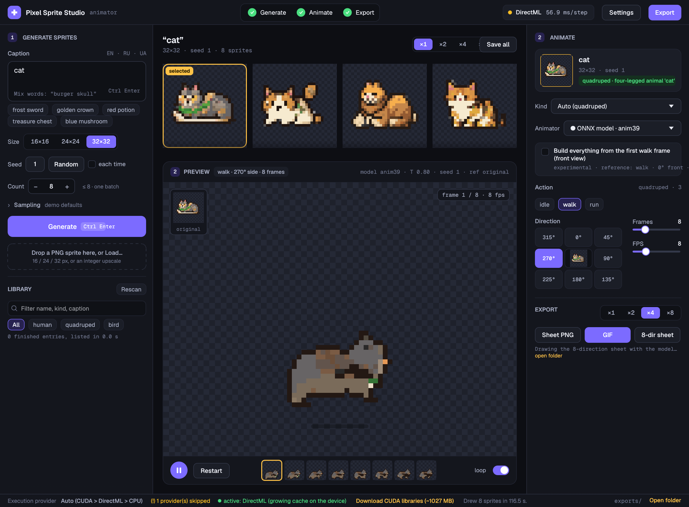
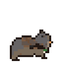

# Pixel Sprite Studio

**Text → pixel sprite → animation, on your own machine.** A native Windows app: type a caption, get pixel-art
sprites, pick one and animate it — walk, run, punch, a whole fight scene — then export a sprite sheet or a GIF.

No Python, no install, no account. Two small transformer models run locally in ONNX Runtime, on an NVIDIA card
(CUDA), on any DirectX 12 card (DirectML) or on the processor.



| walk cycle (32 px, ×4) | fight scene (16 px, ×4) |
|---|---|
|  |  |

These are straight exports from the release build on its first run, not hand-picked: see *What to expect*.

## Download and run

1. Download `PixelSpriteStudio-v0.1.0-win-x64.zip` from
   [Releases](https://github.com/umanets/pixelsprite-animator/releases/latest) (81 MB) and unzip it anywhere you can
   write to.
2. Run `PixelSpriteStudio.exe`. Windows SmartScreen may warn about an unsigned app: **More info → Run anyway**.
3. **First start:** the app downloads its models into the `models` folder next to the exe — about 400 MB, once. The
   status bar at the bottom shows the progress; it needs an internet connection.
4. Type a caption, press **Generate**, click a sprite, pick an action on the right.

Requirements: Windows 10 (1803 or later) or Windows 11, x64. Nothing else has to be installed.

### Graphics card

| You have | What runs | What to do |
|---|---|---|
| NVIDIA card, recent driver | CUDA — the fastest | Click **Download CUDA libraries** in the status bar (about 1 GB, once), restart the app. No CUDA Toolkit needed. |
| Any other DirectX 12 card, or NVIDIA without the libraries | DirectML | Nothing; this is what the app uses out of the box. |
| No usable card | Processor | Nothing; slower. |

The app tries CUDA, then DirectML, then the processor, and tells you in the status bar which one is active and why
the others were skipped. The CUDA build is for **CUDA 13**; the driver must support it (tested with 610.88).

Measured on an RTX 5070 Ti (the card was shared with other work):

| | CUDA | DirectML |
|---|---|---|
| 8 sprites, 16 px | 3.5 s | 12.7 s |
| 8 sprites, 32 px | 25 s | 117 s |
| 8-direction walk, 16 px | 6 s | not measured |
| 8-direction walk, 32 px | 49 s | not measured |

The processor path works but was not timed for this release.

## What it does

**1 · Generate.** A port of the [pixelsprite web demo](https://umanets.github.io/pixelsprite/demo/): for the same
caption, size, seed and settings it draws the demo's sprites, pixel for pixel. Captions in English, Russian and
Ukrainian; sizes 16, 24 and 32 px; caption mixing (`burger skull` draws skull-burgers); draw a silhouette and let the
model fill it; up to 32 sprites per run; save PNGs at ×1 – ×8. You can also drop in your own PNG sprite.

**2 · Animate.** The animation model (AnimGPT, 39 M parameters) takes one sprite, turns the character to each of 8
directions and draws the action frame by frame, using only the colours of your sprite. Humans have 17 actions (idle,
walk, run, jump, punch, kick, slash, cast, …), four-legged animals walk and run, birds fly. A **fight scene** strings
walk, kicks, punches and a run into one timeline.

**3 · Export.** A sprite sheet (PNG), a GIF, an 8-direction sheet, the scene as a GIF.

## What to expect

This is a research release, and the two models are small.

* **Sprites** are as good as the web demo's.
* **Animation is uneven.** Motion is usually right; keeping the character recognisable after a turn often is not.
  Dark sprites tend to collapse into a silhouette, 16 px more than 32 px, and animals fare better than humans in
  profile. Try another sprite of the same run, another seed, or 32 px.
* The option *Build everything from the first walk frame* is experimental and off by default: measured, it does not
  reduce colour drift and costs silhouette quality.
* Windows only. The exe is not code-signed.

## Models and licences

The **code** is MIT (`LICENSE`). The **weights are for non-commercial use** and are not in this repository; the app
downloads them from Hugging Face:

| Model | Repository | Licence |
|---|---|---|
| pixelsprite canvas v2 (text → sprite) | [`ihor-umanets/pixelsprite-canvas-v2`](https://huggingface.co/ihor-umanets/pixelsprite-canvas-v2) | CC BY-NC 4.0 |
| AnimGPT (sprite → animation) | [`ihor-umanets/pixelsprite-animgpt`](https://huggingface.co/ihor-umanets/pixelsprite-animgpt) | CC BY-NC 4.0, "Built with Qwen" |
| Text encoder | [`Xenova/paraphrase-multilingual-MiniLM-L12-v2`](https://huggingface.co/Xenova/paraphrase-multilingual-MiniLM-L12-v2) | Apache-2.0 (base model) |

Everything else that ships in the zip or is downloaded is listed in [`THIRD_PARTY.md`](THIRD_PARTY.md).

## Build from source

```
cargo build --release
target\release\animator_ui.exe
```

Rust 1.92 or later, Windows x64, MSVC toolchain. `ort` downloads the ONNX Runtime build at compile time.
`scripts\package.ps1` makes the release zip. Architecture, the parity checks against the web demo and against
PyTorch, and the known gaps are in [`docs/DEVELOPMENT.md`](docs/DEVELOPMENT.md).

## Related

* [pixelsprite](https://github.com/umanets/pixelsprite) — the sprite model, its training code and the web demo.
